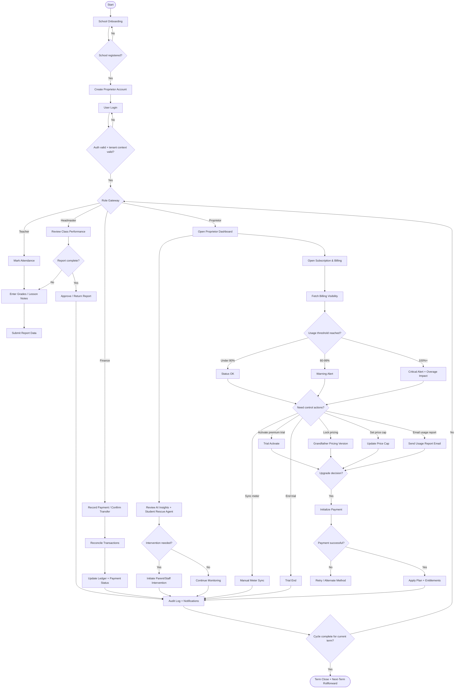

# EduPulse SMT: AI-Driven School Governance, Revenue Integrity & Subscription Intelligence

EduPulse SMT is a multi-tenant SaaS platform for Ghanaian schools that combines academic operations, payment governance, and usage-based subscription controls in one system.

## 🚀 Current Implementation Snapshot

### Core Platform
- Multi-tenant authentication and school-level data isolation (`JWT + X-School-ID + tenant guard`)
- Role-based access control across `proprietor`, `headmaster`, `teacher`, `finance`, and `admin`
- Dynamic school branding and configurable school settings
- Audit-oriented workflows for sensitive operations

### Academic Operations
- Attendance tracking and summaries
- Grade entry and report-card generation workflows
- Report builder with staged approvals (teacher → headmaster → proprietor)
- Lesson notes and academic analytics tooling
- Exam papers workflow (teacher authoring + headmaster/proprietor review) for Premium tenants
- AI Exam Assistant for guided question generation (Premium only)

### Finance & Payments
- Manual and digital payment recording
- Reconciliation workflows and transaction history
- Payment tracking dashboards and oversight views
- Immutable/auditable ledger-style operational records

### Subscription, Metering & Monetization (Metronome-Aligned)
- Active-student metering with manual sync endpoint
- Billing visibility endpoint with cost breakdown and threshold alerts (`80% warning`, `100% critical`)
- Premium trial entitlement lifecycle (status, activate, end, expiry checks)
- Pricing grandfathering/version lock endpoint
- Price-cap management endpoint for predictable billing control
- Usage-report email trigger endpoint and backend email service utilities

### Frontend Billing Experience
- Billing visibility widget (meter + alerts + cost transparency)
- Trial management widget (activate/end, countdown, state-aware messaging)
- Billing control panel (price cap toggle, cap amount, budget feedback)
- Email usage report trigger button from billing UI

## 🧠 AI & Governance Features
- AI-assisted academic insight surfaces
- Student Rescue Agent for prioritized at-risk student intervention
- Risk-aware governance loops for intervention workflows
- Remote oversight feed for proprietor monitoring
- Operational analytics to support school decision-making

### Student Rescue Agent
- Combines tuition, feeding, attendance, and academic signals into one rescue queue
- Scores each flagged student by intervention urgency and explains the drivers
- Uses contextual tuition-risk logic so newly reopened schools and recently paying families are not falsely escalated
- Recommends next actions such as guardian contact, payment-plan follow-up, or academic support
- Powers the proprietor dashboard intervention view and live-feed prioritization
- Sends rescue emails directly from the proprietor dashboard
- Provides a dedicated Rescue Activity Center page for intervention operations
- Includes ready-to-send guardian contact templates for call, SMS/WhatsApp, email, and meeting brief
- Allows the rescue email subject and body to be edited before sending
- Logs intervention outcomes so leadership can track what action has already been taken on each case
- Includes case-status reporting for open, in-progress, and resolved rescue work
- WhatsApp sending remains intentionally deferred for now because of cost; draft copy is available, but delivery is not yet enabled

## 💳 Registration & Billing Flow (Current)
- Tenant registration supports plan selection at onboarding.
- If `Free` is selected: registration completes and user proceeds to login.
- If `Basic` or `Premium` is selected: payment is initialized immediately at registration and user is redirected to Paystack.
- After successful payment verification, user is redirected to login and receives one welcome email.
- Duplicate registration welcome emails are prevented by audit-logged single-send checks.

## 🧩 API Highlights (Recent)
- `GET /api/proprietor/student-rescue-agent`
- `GET /api/proprietor/student-rescue-agent/contact-templates/<student_id>`
- `GET /api/proprietor/student-rescue-agent/report`
- `POST /api/proprietor/student-rescue-agent/outcome`
- `POST /api/proprietor/student-rescue-agent/send-email`
- `GET /api/school/subscription/billing-visibility`
- `POST /api/school/subscription/meter/sync`
- `GET /api/school/subscription/trial/status`
- `POST /api/school/subscription/trial/activate`
- `POST /api/school/subscription/trial/end`
- `POST /api/school/subscription/lock-pricing`
- `GET /api/school/subscription/price-cap`
- `POST /api/school/subscription/price-cap`
- `GET /api/school/subscription/usage-stats`
- `POST /api/school/subscription/usage-report/send`
- `GET /api/platform/registration-email-trace`

## 🔄 End-to-End Workflow (BPMN-Style with Gateways)



## 🧱 Tech Stack
- **Backend**: Flask, SQLAlchemy, Alembic, JWT
- **Frontend**: React (Vite), Tailwind, Axios
- **Database**: SQLite/PostgreSQL-compatible data model patterns
- **Security**: Password hashing, role/tenant middleware, protected endpoints

## 🧪 Validation Status
- Migration and subscription-metering updates applied
- Frontend billing widgets integrated and built successfully
- Test suite status: `86 passed, 0 failed`

## 📦 Run Locally

```bash
docker compose up --build
```

## 📁 Helpful Docs
- `docs/operations/internal/BUSINESS_OPERATIONS_INDEX.md`
- `docs/operations/internal/README.md`
- `docs/operations/internal/LEGAL_COUNSEL_DOSSIER.md`
- `docs/operations/internal/LEGAL_COUNSEL_PACKET.md`
- `docs/operations/internal/LAWYER_COVER_EMAIL.md`
- `docs/operations/internal/LAWYER_EXECUTIVE_BRIEF.md`
- `docs/operations/internal/LAWYER_TECHNICAL_SYSTEM_SUMMARY.md`
- `docs/operations/internal/IP_ASSET_INVENTORY.md`
- `docs/operations/internal/GHANA_DATA_PROTECTION_TECHNICAL_BRIEF.md`
- `docs/operations/internal/FOUNDER_IP_AND_CONFIDENTIALITY_CHECKLIST.md`
- `docs/operations/internal/CONTRIBUTOR_IP_ASSIGNMENT_TEMPLATE.md`
- `docs/operations/internal/CONFIDENTIALITY_NDA_TEMPLATE.md`
- `BUSINESS_PROCESS_MODEL.md`
- `docs/operations/internal/STANDARD_OPERATING_PROCEDURES.md`
- `docs/operations/internal/ONBOARDING_CHECKLIST.md`
- `docs/operations/internal/ONBOARDING_CHECKLIST_TEMPLATE.md`
- `docs/operations/internal/ONBOARDING_CHECKLIST_EXAMPLE.md`
- `docs/operations/internal/OPERATIONS_HANDOFF.md`
- `docs/operations/internal/OPERATIONS_HANDOFF_SAMPLE.md`
- `docs/operations/internal/INCIDENT_UPDATE_TEMPLATE.md`
- `docs/operations/internal/INCIDENT_UPDATE_SAMPLE.md`
- `docs/operations/customer/README.md`
- `docs/operations/customer/SCHOOL_SEND_PACKAGE.md`
- `docs/operations/customer/SCHOOL_IMPLEMENTATION_GUIDE.md`
- `docs/operations/customer/SCHOOL_IMPLEMENTATION_GUIDE_SAMPLE.md`
- `docs/operations/customer/SCHOOL_WELCOME_PACK.md`
- `docs/operations/customer/SCHOOL_WELCOME_PACK_SAMPLE.md`
- `docs/operations/customer/SCHOOL_WELCOME_EMAIL_TEMPLATE.md`
- `docs/operations/customer/SCHOOL_WELCOME_EMAIL_TEMPLATE_SAMPLE.md`
- `docs/operations/customer/ONBOARDING_EMAIL_TEMPLATE.md`
- `docs/operations/customer/ONBOARDING_EMAIL_TEMPLATE_SAMPLE.md`
- `docs/operations/customer/SCHOOL_CLIENT_LAUNCH_PACKET.md`
- `docs/operations/customer/SCHOOL_CLIENT_LAUNCH_PACKET_SAMPLE.md`
- `docs/operations/README.md`
- `BPM_QUICK_REFERENCE.txt`
- `STUDENT_RESCUE_AGENT.md`
- `PAYMENT_INTEGRATION.md`
- `SUBSCRIPTION_FEATURES.md`
- `REPORT_BUILDER_GUIDE.md`
