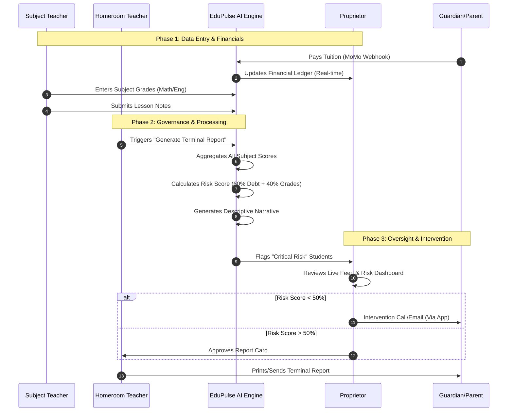

# EduPulse: AI-Driven School Governance & Revenue Protection

EduPulse is a professional **Multi-Tenant SaaS (Software as a Service)** platform designed to solve revenue leakage and academic risk in Ghanaian schools. 

## 🚀 Professional Multi-Tenant Architecture
Based on enterprise standards for medium and large businesses, EduPulse implements five core pillars of multi-tenancy:

1. **Business Authentication**: Users authenticate using Organization IDs and Business Credentials (Staff IDs) rather than generic global accounts.
2. **UI Configurability**: The interface dynamically adapts to the school's branding. CSS variables are injected at login to apply the school's primary color and logo.
3. **Custom Business Rules**: Proprietors define their own workflows, such as "Sack-Risk" thresholds and canteen cutoff times, via a dedicated Settings panel.
4. **Schema Adaptation**: Our database utilizes generic subject models and JSON-based custom attributes, allowing schools to extend the data model without backend changes.
5. **Multi-level Access Control**: Robust middleware ensures complete data isolation. Every request is intercepted by a Multi-Tenant Guard that restricts data access strictly to the user's organization.

## 🧠 AI & Operational Features
- **Sack-Risk Pulse**: A predictive engine that correlates academic performance trends with financial payment consistency to prevent student dropouts.
- **Zero-Waste Canteen Manifest**: Real-time meal portion calculation based on morning attendance and fee payment status to eliminate food waste.
- **Remote Oversight Feed**: A live audit trail allowing traveling proprietors to monitor staff actions and MoMo revenue reconciliation in real-time.

## 🔄 System Workflow
The following diagram illustrates the **End-of-Term Governance Loop**, showing how data flows from teachers to the AI engine and finally to the Proprietor.



## �️ Tech Stack
- **Backend**: Python (Flask) with SQLAlchemy & JWT Authentication.
- **Frontend**: React (Vite) with Tailwind CSS for dynamic branding.
- **Database**: PostgreSQL (Multi-tenant isolated rows).
- **Security**: Bcrypt password hashing and Row-Level Security (RLS) simulation via Middleware.

## 📦 Deployment
The system is fully containerized for production readiness:
```bash
docker-compose up --build