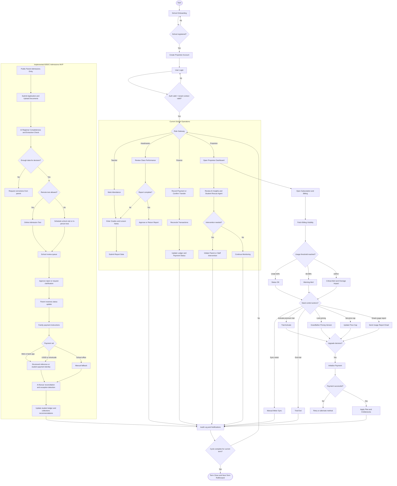

# EduPulse SMT: AI-Driven School Governance, Revenue Integrity & Subscription Intelligence

EduPulse SMT is a multi-tenant SaaS platform for Ghanaian schools that combines academic operations, payment governance, and usage-based subscription controls in one system.

## 🚀 Current Implementation Snapshot

### Core Platform
- Multi-tenant authentication and school-level data isolation (`JWT + X-School-ID + tenant guard`)
- Role-based access control across `proprietor`, `headmaster`, `teacher`, `finance`, and `admin`
- Dynamic school branding and configurable school settings
- Audit-oriented workflows for sensitive operations
- External-provider school KYB verification with automatic approve/review outcomes

### Academic Operations
- Attendance tracking and summaries
- Grade entry and report-card generation workflows
- Report builder with staged approvals (teacher → headmaster → proprietor)
- Lesson notes and academic analytics tooling

### Finance & Payments
- Manual and digital payment recording
- Reconciliation workflows and transaction history
- Payment tracking dashboards and oversight views
- Immutable/auditable ledger-style operational records

### Subscription, Metering & Monetization (Metronome-Aligned)
- Active-student metering with manual sync endpoint
- Billing visibility endpoint with cost breakdown and threshold alerts (`80% warning`, `100% critical`)
- Premium trial entitlement lifecycle now uses a fixed 30-day activation window with no trial-only discounting
- Billing responses now distinguish `base_plan` from the current trial-driven `effective_plan`
- Post-trial conversions prorate only by remaining term days under the normal paid-plan price model
- Paid plan upgrades must complete through Paystack before entitlements are granted; direct plan changes are limited to non-paid transitions such as downgrades
- Pricing grandfathering/version lock endpoint
- Price-cap management endpoint for predictable billing control
- Usage-report email trigger endpoint and backend email service utilities
- National basic-school calendar fallback when a school's active term is missing or does not cover today

### Frontend Billing Experience
- Billing visibility widget (meter + alerts + cost transparency)
- Trial management widget (activate/end, countdown, state-aware messaging)
- Billing control panel (price cap toggle, cap amount, budget feedback)
- Email usage report trigger button from billing UI
- Public and in-app pricing surfaces now route paid upgrades through Paystack checkout and keep downgrade flows direct

### Student Profiles, Admissions & Demo Data
- Parent admissions now support passport-photo upload and keep uploaded source documents in school-scoped storage
- Approved admissions can copy the passport photo into `Student.profile_picture`
- Student profiles now expose a document vault with upload and download support for direct learner documents plus linked admission records
- The demo seed now rebuilds the schema from Alembic migrations and repopulates a richer CCA Ofankor environment with profile photos, documents, linked admissions records, billing data, and multi-term report history

## 🧠 AI & Governance Features
- AI-assisted academic insight surfaces
- Student Rescue Agent for proprietor and headmaster rescue intervention workflows
- Risk-aware governance loops for intervention workflows
- Remote oversight feed for proprietor monitoring
- Operational analytics to support school decision-making

### Student Rescue Agent
- Shared rescue queue for proprietor and headmaster intervention oversight
- Combines tuition, feeding, attendance, and academic signals into one rescue queue
- Scores each flagged student by intervention urgency and explains the drivers
- Uses contextual tuition-risk logic so newly reopened schools and recently paying families are not falsely escalated
- Recommends next actions such as guardian contact, payment-plan follow-up, or academic support
- Powers the proprietor dashboard intervention view, the headmaster rescue workspace, and live-feed prioritization
- Sends rescue emails directly from proprietor and headmaster rescue views
- Provides a dedicated Rescue Activity Center page for intervention operations
- Includes ready-to-send guardian contact templates for call, SMS/WhatsApp, email, and meeting brief
- Allows the rescue email subject and body to be edited before sending
- Logs intervention outcomes so leadership can track what action has already been taken on each case
- Includes case-status reporting for open, in-progress, and resolved rescue work
- WhatsApp sending remains intentionally deferred for now because of cost; draft copy is available, but delivery is not yet enabled

## 💳 Registration & Billing Flow (Current)
- Tenant registration supports plan selection at onboarding.
- If `Free` is selected: registration completes immediately and user proceeds to login.
- If `Basic` or `Premium` is selected: payment is initialized immediately at registration and user is redirected to Paystack.
- After successful payment verification, user is redirected to login and receives one welcome email.
- Duplicate registration welcome emails are prevented by audit-logged single-send checks.
- School verification can be submitted by the proprietor and automatically screened through a configured KYB provider.
- Clean provider outcomes auto-approve the school; flagged outcomes move to `review_required` for platform compliance review.
- If provider config is unavailable or the provider is temporarily unreachable, local fallback heuristics still evaluate the submission.

## 🏫 B2B2C Direction
- EduPulse remains school-led B2B infrastructure, with a parent-facing access layer rather than a marketplace-style standalone B2C product.
- The school stays the paying customer and system owner; parents become transacting users for admission, status tracking, and payments.
- The current B2B2C implementation includes an AI Registrar MVP with public parent admissions intake, application tracking, school review actions, and parent-safe payment instructions.
- The next major workflow expansion after this MVP is an AI Bursar for payment reconciliation and collections decision support.
- Remote parent journeys must stay inclusive for Ghana, so web flows and low-friction payment rails such as shortcode / USSD-compatible routes remain part of the target design.

### AI Employee Packaging
- The platform remains subscription-led at the contract layer.
- AI Registrar is bundled into the current paid subscriptions so every Basic and Premium school gets the admissions workflow by default.
- Already-shipped AI capabilities such as Student Rescue Agent remain bundled in Premium.
- Future AI Employees should be sold as optional workflow add-ons rather than forced into every school subscription.
- The recommended default for those future workers is fixed add-on pricing per school per term, not per-task charging.
- Lower Premium add-on pricing for future workers can still reflect the fact that Premium already bundles adjacent analytics and governance value.

### Current vs Planned Boundaries
- Current: school-managed admissions, public parent admission application, document upload, AI completeness checks, online-vs-school-visit admission routing, family-facing payment/status pages, stable payment identity plus structured reference parsing, staff-controlled approval workflows, Student Rescue Agent, and audited finance operations.
- Current admissions decisioning includes status-page feedback, email updates, correction resubmission, and optional approval-only PDF delivery when a school enables it.
- Next build: AI Bursar exception queues, richer parent balance/status visibility, and more automated admissions extraction/scoring.
- Future only: fully autonomous admission approval, multilingual voice bots, predictive dropout automation, and pure outcome-based billing for AI employees.

### Payment Architecture Direction
- The recommended product default is one stable student or family payment identity, with structured references to categorize tuition, feeding, transport, uniforms, admission, and other fee types across bank app, USSD, and manual fallback channels.
- Legacy Paystack route or DVA records may still exist in historical data, but new route setup is retired and the product should be treated as reference-first.
- Shortcode and low-literacy payment paths remain strategically important and should not be removed.

### Recent Workflow Updates
- Feeding fee instructions can now be configured as separate daily, weekly, and monthly plans per school.
- Parent payment instructions emit structured feeding references in the format `STUDENT_IDENTIFIER-FEED-DAY`, `STUDENT_IDENTIFIER-FEED-WEK`, and `STUDENT_IDENTIFIER-FEED-MON`.
- The student identifier in those references is the learner's stable school identifier, typically the student code used throughout EduPulse.
- Proprietor compliance work now lives in a dedicated School Verification tab instead of being buried inside the main dashboard.
- Inventory payment entry for proprietors and inventory managers now supports typed student identifiers with live learner-name lookup instead of requiring a full student dropdown search.

## 🧩 API Highlights (Recent)
- `GET /api/proprietor/student-rescue-agent`
- `GET /api/proprietor/student-rescue-agent/contact-templates/<student_id>`
- `GET /api/proprietor/student-rescue-agent/report`
- `POST /api/proprietor/student-rescue-agent/outcome`
- `POST /api/proprietor/student-rescue-agent/send-email`
- `GET /api/students/<student_id>/payment-codes`
- `GET /api/public/schools/<school_id>/payments/<student_code>`
- `GET /api/public/schools/<school_id>/profile`
- `POST /api/public/schools/<school_id>/admissions/apply`
- `GET /api/public/schools/<school_id>/admissions/status/<status_token>`
- `GET /api/public/schools/<school_id>/admissions/status/<status_token>/decision-pdf`
- `POST /api/public/schools/<school_id>/admissions/status/<status_token>/resubmit`
- `GET /api/admissions/applications`
- `POST /api/admissions/applications/<application_id>/review`
- `GET /api/admissions/applications/<application_id>/documents/<document_id>/download`
- `GET /api/students/<student_id>/documents`
- `POST /api/students/<student_id>/documents`
- `GET /api/students/<student_id>/documents/<document_id>/download`
- `GET /api/school/subscription/billing-visibility`
- `POST /api/school/subscription/meter/sync`
- `GET /api/school/subscription/trial/status`
- `POST /api/school/subscription/trial/activate`
- `POST /api/school/subscription/trial/end`
- `POST /api/school/terms/import-national-calendar`
- `POST /api/school/subscription/lock-pricing`
- `GET /api/school/subscription/price-cap`
- `POST /api/school/subscription/price-cap`
- `GET /api/school/subscription/usage-stats`
- `POST /api/school/subscription/usage-report/send`
- `GET /api/platform/registration-email-trace`
- `GET /api/school/verification`
- `PUT /api/school/verification`
- `GET /api/proprietor/compliance/aml-flags`
- `POST /api/proprietor/compliance/aml-flags/<flag_id>/resolve`
- `GET /api/platform/compliance/schools`
- `POST /api/platform/compliance/schools/<school_id>/decision`
- `GET /api/platform/compliance/aml-flags`
- `POST /api/platform/compliance/aml-flags/<flag_id>/resolve`

Legacy or retired payment-management endpoints are intentionally omitted here. Historical Paystack route-management endpoints have been removed from the active API and are retained only as backward-compatibility context in older records and docs.

## 🛡️ KYB Provider Configuration

EduPulse supports external KYB providers (for example Identitypass, Dojah, Smile ID) via environment variables.

Required:
- `KYB_PROVIDER`
- `KYB_BASE_URL`
- `KYB_API_KEY`

Optional:
- `KYB_VERIFY_PATH` (default `/verify`)
- `KYB_API_KEY_HEADER` (default `Authorization`)
- `KYB_TIMEOUT_SECONDS` (default `20`)

## 🔄 End-to-End Workflow (Current + Implemented MVP)



## 🧱 Tech Stack
- **Backend**: Flask, SQLAlchemy, Alembic, JWT
- **Frontend**: React (Vite), Tailwind, Axios
- **Database**: SQLite/PostgreSQL-compatible data model patterns
- **Security**: Password hashing, role/tenant middleware, protected endpoints

## 🧪 Validation Status
- Migration and subscription-metering updates applied
- Frontend billing widgets integrated and built successfully
- Test suite status: `86 passed, 0 failed`

## 📦 Run Locally

```bash
docker compose up --build
```

## 📁 Helpful Docs
- `B2B2C_AI_EMPLOYEE_ROADMAP.md`
- `docs/operations/internal/BUSINESS_OPERATIONS_INDEX.md`
- `docs/operations/internal/README.md`
- `docs/operations/internal/LEGAL_COUNSEL_DOSSIER.md`
- `docs/operations/internal/LEGAL_COUNSEL_PACKET.md`
- `docs/operations/internal/LAWYER_COVER_EMAIL.md`
- `docs/operations/internal/LAWYER_EXECUTIVE_BRIEF.md`
- `docs/operations/internal/LAWYER_TECHNICAL_SYSTEM_SUMMARY.md`
- `docs/operations/internal/IP_ASSET_INVENTORY.md`
- `docs/operations/internal/GHANA_DATA_PROTECTION_TECHNICAL_BRIEF.md`
- `docs/operations/internal/FOUNDER_IP_AND_CONFIDENTIALITY_CHECKLIST.md`
- `docs/operations/internal/CONTRIBUTOR_IP_ASSIGNMENT_TEMPLATE.md`
- `docs/operations/internal/CONFIDENTIALITY_NDA_TEMPLATE.md`
- `docs/strategy/BUSINESS_PROCESS_MODEL.md`
- `docs/finance/LEGACY_PAYSTACK_ROUTE_METADATA_GUIDE.md`
- `docs/finance/PAYMENT_REFERENCE_FORMAT.md`
- `docs/academics/PARENT_ADMISSIONS_WORKFLOW.md`
- `docs/operations/internal/STANDARD_OPERATING_PROCEDURES.md`
- `docs/operations/internal/ONBOARDING_CHECKLIST.md`
- `docs/operations/internal/ONBOARDING_CHECKLIST_TEMPLATE.md`
- `docs/operations/internal/ONBOARDING_CHECKLIST_EXAMPLE.md`
- `docs/operations/internal/OPERATIONS_HANDOFF.md`
- `docs/operations/internal/OPERATIONS_HANDOFF_SAMPLE.md`
- `docs/operations/internal/INCIDENT_UPDATE_TEMPLATE.md`
- `docs/operations/internal/INCIDENT_UPDATE_SAMPLE.md`
- `docs/operations/customer/README.md`
- `docs/operations/customer/SCHOOL_SEND_PACKAGE.md`
- `docs/operations/customer/SCHOOL_IMPLEMENTATION_GUIDE.md`
- `docs/operations/customer/SCHOOL_IMPLEMENTATION_GUIDE_SAMPLE.md`
- `docs/operations/customer/SCHOOL_WELCOME_PACK.md`
- `docs/operations/customer/SCHOOL_WELCOME_PACK_SAMPLE.md`
- `docs/operations/customer/SCHOOL_WELCOME_EMAIL_TEMPLATE.md`
- `docs/operations/customer/SCHOOL_WELCOME_EMAIL_TEMPLATE_SAMPLE.md`
- `docs/operations/customer/ONBOARDING_EMAIL_TEMPLATE.md`
- `docs/operations/customer/ONBOARDING_EMAIL_TEMPLATE_SAMPLE.md`
- `docs/operations/customer/SCHOOL_CLIENT_LAUNCH_PACKET.md`
- `docs/operations/customer/SCHOOL_CLIENT_LAUNCH_PACKET_SAMPLE.md`
- `docs/operations/README.md`
- `BPM_QUICK_REFERENCE.txt`
- `docs/ai/STUDENT_RESCUE_AGENT.md`
- `docs/finance/PAYMENT_INTEGRATION.md`
- `docs/finance/SUBSCRIPTION_FEATURES.md`
- `docs/academics/REPORT_BUILDER_GUIDE.md`
